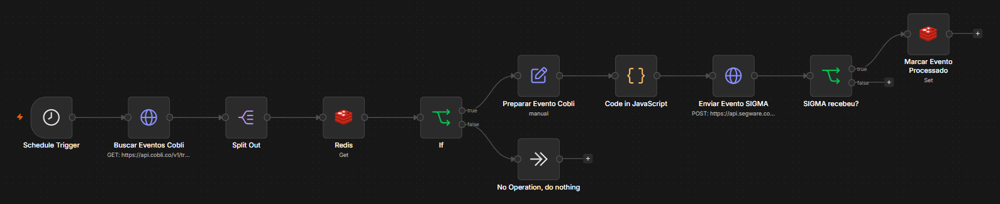
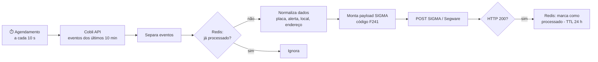

# Reminder Automation — Alertas Cobli → SIGMA

Automação em [n8n](https://n8n.io) que leva os alertas de telemetria veicular da **Cobli** para a central de monitoramento **SIGMA (Segware)** quase em tempo real. Assim, eventos como a saída de um veículo de um bolsão (geofence) chegam ao operador da central sem trabalho manual.

## O problema

A plataforma de rastreamento (Cobli) gera os alertas, mas a equipe de monitoramento trabalha no SIGMA. Sem integração, alguém precisava acompanhar os dois sistemas e repassar cada ocorrência à mão. Isso gerava atraso e risco de perder eventos.

## Como funciona

1. **Coleta:** a cada 10 segundos, o fluxo consulta a API da Cobli e pede os eventos dos últimos 10 minutos, filtrados pela regra e pelos gatilhos configurados.
2. **Deduplicação:** como a janela de 10 minutos se sobrepõe entre execuções, cada evento é verificado no Redis (`cobli:sigma:event:<id>`). Só eventos novos seguem adiante.
3. **Transformação:** os campos relevantes (placa, tipo de alerta, condição, geofence, endereço e dispositivo) são extraídos e convertidos para o formato da API de eventos do SIGMA.
4. **Envio:** o evento é enviado ao SIGMA com o código `F241` e o complemento "Saída do bolsão &lt;local&gt; - &lt;endereço&gt;".
5. **Confirmação:** o evento só é marcado como processado (TTL de 24 h) **depois** que o SIGMA responde `200`. Se o envio falhar, ele é tentado de novo na próxima execução, enquanto ainda estiver na janela de 10 minutos.

## Decisões de projeto

- **Idempotência com Redis:** a janela sobreposta garante que nenhum evento se perca entre execuções, e o Redis evita alertas duplicados na central.
- **Marcar só após sucesso:** falhas temporárias do SIGMA não descartam eventos; a nova tentativa acontece de forma natural.
- **ID de evento determinístico** (`COBLI-<device>-<evento original>`): o mesmo evento sempre gera o mesmo identificador no SIGMA, o que facilita o rastreio.
- **Execução sem erro bloqueante** (`neverError`): o fluxo avalia o status HTTP e não para no primeiro erro.

## Como usar

1. No n8n: **Workflows → Import from File** → `workflows/Automação_de_Alertas.json`.
2. Crie as credenciais e associe-as aos nós indicados com `<<CRIAR CREDENCIAL ...>>`:
   | Nó | Credencial |
   |---|---|
   | Redis / Marcar Evento Processado | Redis |
   | Enviar Evento SIGMA | Header Auth com o token da API Segware |
3. No nó **Buscar Eventos Cobli**, preencha os valores marcados com `<<PREENCHER>>`:
   - `cobli-api-key`: sua chave da API Cobli (de preferência, configure-a como credencial Header Auth)
   - `ruleId` e `triggerIds`: IDs da regra e dos gatilhos de alerta na sua conta Cobli
4. Ative o fluxo.

## Segurança

O fluxo publicado aqui não tem credenciais, chaves de API, IDs de conta nem dados reais de execução. Todos os valores sensíveis foram substituídos por marcadores (`<<PREENCHER>>`).
